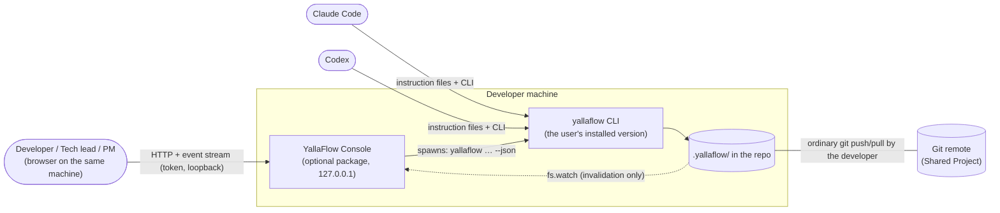
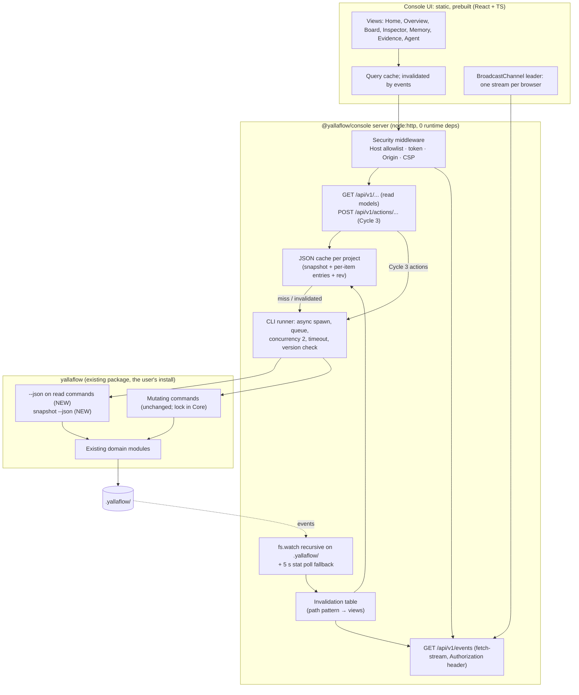
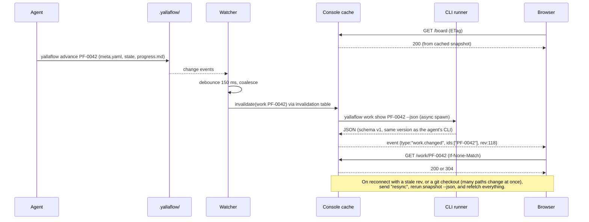
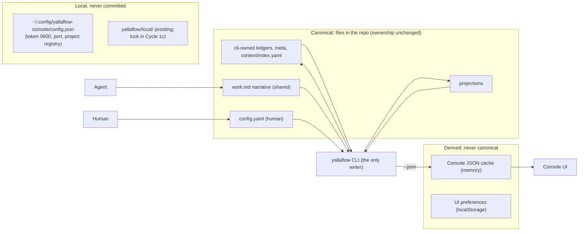
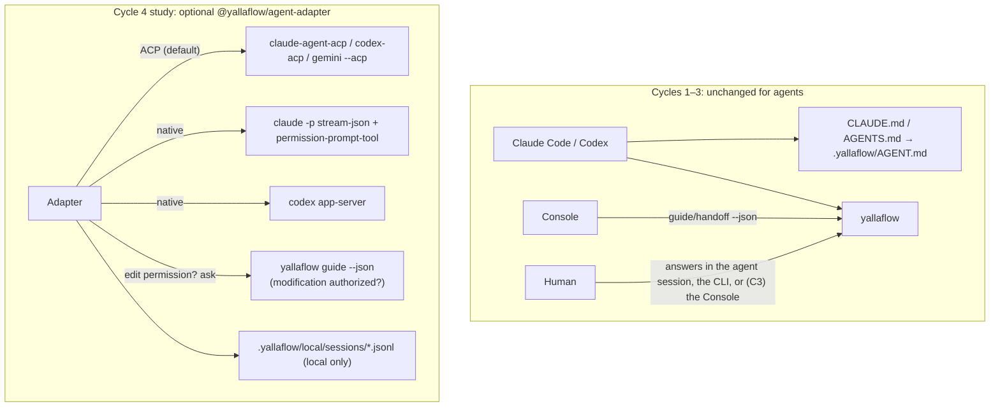
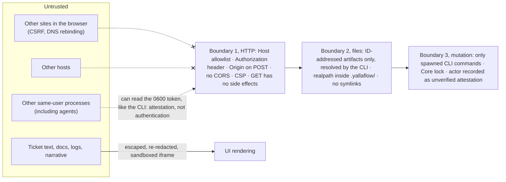
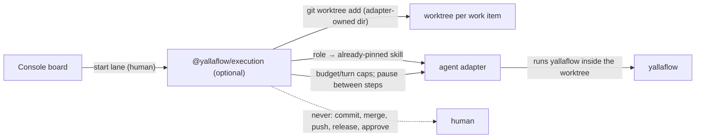

# Target Architecture: YallaFlow Console

> This is a recommendation for owner approval. Nothing here is implemented.
> Facts are cited to `CURRENT_STATE_AUDIT.md` and measurements to `PERFORMANCE_AND_SECURITY.md`.
> **Revision 2** incorporates an independent architecture review (summarized in §11). The main change from revision 1: the Console now reaches Core through the **CLI's versioned `--json` contract**, not by importing Core modules in-process.

## 1. Decision in one paragraph

**[Recommendation]**

**Make the CLI the API.**

1. **Core gains:**
   - versioned **`--json` output** on its read commands, plus one batched `yallaflow snapshot --json`;
   - targeted **read-path performance fixes**;
   - later, a **workspace lock**.

   All three are additive and useful without any Console.
2. **The Console ships as a separate, optional npm package** (`@yallaflow/console`):
   - a zero-dependency Node `http` server bound to loopback;
   - it spawns the **user's own installed `yallaflow`** asynchronously, caches the JSON it returns, and refreshes only what a file-watcher event invalidates;
   - it pushes invalidation events to a **prebuilt** React + TypeScript UI over a header-authenticated event stream.
3. **Writes go through those same CLI commands** (Cycle 3), so the Console cannot diverge from Core's validation, version or locking.
4. **Agents are unaffected.**
5. **Agent control** (chat, monitoring) remains a separate, later, optional adapter package.

## 2. Requirements and how they are met

| Requirement | How |
|---|---|
| The existing CLI stays fully functional | Text output stays the default; `--json` is opt-in |
| Existing data stays compatible; no migration | Cycles 1–2 change no existing file's schema. The new artifacts are listed in §6. |
| No duplicate source of truth | The Console caches CLI JSON in memory and never persists it as truth |
| The UI never edits YAML/JSON directly | The Console has no write path except spawning `yallaflow <mutating command>` |
| Existing validation stays authoritative | It is literally the same process the agent runs |
| Read-only actions do not mutate | Measured: no read command writes `.yallaflow/`. `resume`/`handoff` can rewrite `.git/index` through `git status` (fix P6: `--no-optional-locks`). A contract test hashes `.yallaflow/` **and `.git/index`**. |
| Local-first; no cloud or model calls | Loopback only, no network, no model calls for reads |
| Agent independence | Nothing changes for agents |
| Features stay optional | The Console is a separate package; Core keeps its 4 dependencies |
| Same YallaFlow version as the agent | The Console resolves `yallaflow` from the user's `PATH` and re-checks `yallaflow --version` on every refresh. On a mismatch with what it loaded, or an incompatible `config.yaml yallaflow.minimumVersion`, it goes read-only and shows a banner. |

## 3. Options evaluated

| # | Option | Strengths | Weaknesses | Verdict |
|---|---|---|---|---|
| A | The brief's hypothesis: Console → Local API → Core → State | clean layering | does not say *how* the API reaches Core | refined into F′ |
| B | Spawn the CLI and parse its prose output | no Core change | prose is not a contract | rejected |
| C | Console reads `.yallaflow/` files directly | fast to build | duplicates Core's normalization and rules. **The prototype does this and already drifted from Core** (review finding L4: wrong gate statuses, a missing CONCLUSION rule) | **prototype only** |
| D | **Static HTML export** from `--json` | no server, no security surface, shareable | not live, no actions | **ship it as a stepping stone** (Cycle 1b) |
| E | IDE extension (webview) | lives in the editor | ties the Console to one IDE | later, on the same `--json` contract |
| F | Service layer imported in-process (revision 1's pick) | fastest warm reads (`guide` 5 ms against 159 ms) | **version skew** with the agent's CLI; `spawnSync` git calls block the server; exposes a JS API (and on-disk shapes) under SemVer; lock re-entrancy within one process | **fallback optimization**, only if measurements demand it |
| **F′** | **CLI as API:** the Console spawns `yallaflow … --json` asynchronously, with watcher-driven invalidation and per-item refresh | the same binary, version and validation as the agent; spawns are async, so the server never blocks; the public contract is JSON Schema, not JS internals; writes inherit CLI locking; parity is trivial | about 150 ms startup per spawn; initial load at 1,000 items depends on Core's read-path fixes | **recommended** |
| G | Squad-Kit-style orchestrator | the full "do it for me" experience | lock-in, security surface, against governance | rejected for Core; a Cycle 4 study only, as a separate package |

**Why F′ is fast enough** [Measured]:
- spawns scale with *changes*, not with page views;
- refreshing one item costs one `guide <id> --json`-style call, about 160–280 ms;
- the live-update target of 1 s p95 leaves room for that;
- the initial load is one `snapshot --json`.

| Initial load | Today | After the read-path fixes |
|---|---|---|
| 23 items | about `status` + `context status`, ≈0.5 s | — |
| 200 items | ≈1.8 s | under 1 s, hypothesized: hashing drops 390 → 17 ms at 990 facts, and `brief`'s doctor call accounts for 97% of its in-process time |
| 1,000 items | ≈6.5 s | the prerequisite fixes are needed to reach usable times |

## 4. Diagrams

### 4.1 System context

### 4.2 Containers and components

### 4.3 Read and live update

### 4.4 State ownership

### 4.5 Agent integration

### 4.6 Security and trust boundaries

### 4.7 Future managed execution (concept only)

## 5. Technology evaluation

| Concern | Candidates | Evidence | Recommendation |
|---|---|---|---|
| HTTP server | **node:http** vs Hono 4.13 vs Express | Hono: 0 deps, 1.27 MB unpacked, plus `@hono/node-server` (137 KB). The Console needs about 15 GET routes, 1 stream and about 6 POSTs. | **node:http** with a small router. It needs no dependencies, matching Core's discipline. Switch to Hono if routes pass about 40. |
| Live updates | SSE (`EventSource`) vs fetch-streamed events vs WebSocket vs polling | `EventSource` cannot send an `Authorization` header. HTTP/1.1 allows 6 connections per origin. | **Fetch-streamed `text/event-stream` with the header.** A `BroadcastChannel` leader tab holds the only stream and fans out to other tabs. Events carry invalidations only. |
| File watching | `fs.watch` recursive vs chokidar 6 | Measured on Linux, Node 20.16 and 22: new directories and temp+rename writes reported in about 5 ms | **fs.watch** on `.yallaflow/` plus a 5 s `stat` poll fallback; poll-only on NFS, WSL `/mnt` and container bind mounts. macOS and Windows: **unverified**. |
| Core access | CLI `--json` (F′) vs in-process import (F) | Warm in-process `guide`: 5 ms; spawn: 159 ms. Heavy reads gain little either way (`status` at 200 items: 1,007 ms in-process against 1,417 ms spawned). | **F′.** Revisit F only if Cycle 1 targets are missed after the Core fixes. |
| UI | **React 19 + TS + Vite, prebuilt** vs Preact 11 vs vanilla | react-dom 19.3 bundles to roughly 45–60 KB gzipped (approximate); Preact is about 5 KB gzipped. The vanilla prototype (about 500 dense lines) re-renders whole views. | React, prebuilt (dev dependencies only). Preact is acceptable if size wins (D4). |
| Graphs | d3-force vs none | Lineage chains are linear (max depth 5) | No graph library. A lineage strip plus a timeline. |
| Server language | JS vs TS | Core is plain JS | Plain JS with JSDoc for the server; TS only for the UI |

**Budgets:**
- Console tarball ≤ 1.5 MB, with 0 runtime dependencies;
- initial-route UI ≤ 250 KB gzipped;
- Core unchanged at 4 dependencies.

**Packaging:** the Console declares `yallaflow` as a **`peerDependency`** (`>=1.2.0 <2`) for documentation only. At runtime it uses the `yallaflow` on `PATH`, the same binary the agent uses, and refuses to start if that binary is older than the required `--json` schema version.

## 6. Data changes and new artifacts

"No schema change" means **no change to any existing file's schema**. These artifacts are new:

| Cycle | Change | Kind | Compatibility |
|---|---|---|---|
| 1a | `--json` on `brief`, `status`, `guide`, `handoff`, `resume`, `context status/show/history`, `verify list`, `doctor`, `convergence status`, `qc status`, `demo status`. New `work show <id> --json` and `snapshot --json`. All carry `{schema: "yallaflow.<name>/v1"}`. | new output contract (JSON Schema, SemVer-covered) | Text output unchanged |
| 1a | Read-path fixes P1–P7 (hash memoization, no doctor in `brief`, DONE shortcut, per-request load cache, `--no-optional-locks`, lazy imports) | code | Behavior unchanged; verified by golden tests |
| 1c (Core 1.2.x track, gates Cycle 3) | Lock at **`.yallaflow/local/lock`**, added to `STATE_OWNERSHIP`; `init` and `upgrade` print a `.gitignore` hint for single-user workspaces, never editing `.gitignore` silently. Unique temp names, atomic `writeYaml`, retry on `EPERM`/`EBUSY` (Windows), exclusive-`mkdir` IDs, verify's V-### allocated once. | new local file + code | Old CLIs ignore the lock, so **mixed versions writing concurrently is unsupported**. Enforce through `minimumVersion`. |
| 3 | Optional `attestation` on gate responses, question answers, baseline and demo approvals, and knowledge promotion: `{recordedVia: "cli"\|"console"\|"adapter", claimedBy?: string, verified: false}`. **No default human name.** `claimedBy` is set only when a human typed it. | additive field in committed ledgers | Old readers ignore it. **Not reversible once committed**, so the owner must approve it (D6). |
| 3 | Optional `artifactHash` on gate approvals (the hash of the spec/plan the human saw) | additive | Same |
| 3 (decision D7) | Structured stage history: keep parsing `progress.md` in Core and expose it in `work show --json` (recommended), or add `progress.yaml stages[]` | — | Recommend parsing until a need is measured |
| 4 | `.yallaflow/local/sessions/*.jsonl` | local only | Never committed |
| Console | `~/.config/yallaflow-console/config.json` (0600): token, port, registered project roots | user-local | — |

**One command surface (fixes review L1):**
- the Console binary is `yallaflow-console`, with `start`, `add <path>`, `remove <path>`, `export --out <dir>` and `open`;
- Core gains **no** console subcommand;
- `yallaflow console` is not added; the docs point to the separate package.

## 7. API surface (Cycle 1 draft)

All endpoints sit under `/api/v1`. Payloads are the CLI's `--json` schemas (plus `rev`), so **the Console's API and the CLI's contract are the same contract.**

| Method | Path | CLI source |
|---|---|---|
| GET | `/projects` | console config, plus `yallaflow brief --json` per project |
| GET | `/projects/:p/snapshot` | `yallaflow snapshot --json` (cached) |
| GET | `/projects/:p/work/:id` | `yallaflow work show <id> --json`. Includes `evaluateAdvance({mutate:false})` blockers (which also covers gates that were never requested), guidance and the delivery summary |
| GET | `/projects/:p/needs-you` | derived from the snapshot's per-item **Core blockers**, never from raw `reviews.yaml` |
| GET | `/projects/:p/memory` | `yallaflow context status --json` + `context list --json` |
| GET | `/projects/:p/memory/:ctx` | `yallaflow context show <ctx> --json` + `context history <ctx> --json` |
| GET | `/projects/:p/evidence` | `verify list --json`, `convergence status --json`, `qc status --json`, `demo status --json` |
| GET | `/projects/:p/work/:id/runs/:v/log?offset=&limit=` | a new `yallaflow verify log <id> <V-###> --offset --limit` (redacted, max 256 KB) |
| GET (stream) | `/events` | Console-internal invalidation stream |
| POST (C3) | `/projects/:p/work/:id/questions/:q/answer` | `yallaflow question answer <id> --id Q --answer TEXT --via console [--claimed-by NAME]` |
| POST (C3) | `/projects/:p/work/:id/gates/:g/approve` | `yallaflow approve <id> --stage G --note TEXT --artifact-hash H --via console`. **Offered only when Core reports that gate as the current blocker.** |

**Proposed CLI additions used above** (none exist today): every `--json` flag, `work show`, `snapshot`, `verify log`, and the `--via` / `--claimed-by` / `--artifact-hash` options. The existing commands they extend are `brief`, `status`, `guide`, `handoff`, `resume`, `context status|list|show|history`, `verify list`, `convergence status`, `qc status`, `demo status`, `question answer` and `approve` (see `src/cli.js` USAGE).

**Not exposed:**
- source originals;
- `local/`;
- any path-addressed read;
- verification or shell execution;
- stage advance;
- checkpoints.

## 8. Cache invalidation table (fixes review M4)

| Changed path | Invalidates |
|---|---|
| `work/<id>/**` | that item, its parent (if `meta.parent`) and its children (`decomposition.yaml`), Home and Needs-you aggregates |
| `context/index.yaml` | memory, overview, Needs-care, every item's knowledge tab |
| `config.yaml` | **everything** (interaction mode changes every item's guidance) |
| `state/current.yaml`, `local/state/**` | Home, the Agent view |
| `sources/**` | the source list, the Sources panel of linked items |
| more than 50 paths within 1 s (git checkout, pull) | full resync |
| repository files outside `.yallaflow/` | **not watched.** Memory freshness shows "checked at <time>" with a **Recheck** button, plus a 60 s TTL while the Memory view is open. This addresses review H1: freshness is always Core's SHA-256 result, never an mtime guess. |

## 9. Guarantees and how they are enforced

1. **Read-only GETs.** A contract test hashes `.yallaflow/` and `.git/index` before and after every GET and every `--json` command, on all fixtures.
2. **No direct writes.** The Console source contains no `fs.write*` outside its own config file, enforced by a lint rule and a grep test. All mutations go through `spawn('yallaflow', …)`.
3. **Same validation and version.** The Console runs the user's own CLI. On a version mismatch it becomes read-only.
4. **Auditability.** Console actions add `attestation.recordedVia = "console"` and land in the same ledgers.
5. **Human gates, stated honestly.** The Console requires a human-typed note and the `artifactHash` of what was shown. **It cannot prove that a human clicked**, because any same-user process can read the token, just as any process can run the CLI today. The UI and the ledgers label console approvals "unverified attestation". **No AGENT.md rule gives console approvals extra weight.**

## 10. Rejected ideas

- **SQLite read cache.** Not needed at the measured scale; a JSON cache in memory is enough.
- **Console inside the `yallaflow` package.** It would add frontend assets to every install.
- **Force-directed knowledge graph.** It would imply relationships that are not stored.
- **A `YALLAFLOW_NO_LOCK` escape hatch.** Any agent could set it. A stale lock is handled by `yallaflow doctor` (report) plus a human-run `yallaflow doctor --clear-lock` on the same host. The lock is never stolen automatically across hosts.

## 11. Changes made after the independent review

| Review finding | Change |
|---|---|
| C1: actor defaults misattribute agent-relayed approvals; console approvals given extra trust | `attestation` model with `verified: false`, no default name, no AGENT.md elevation (§6, §9.5) |
| C2: version skew between the Console's Core and the agent's CLI | F′: the Console spawns the user's CLI, with a version check per refresh (§2, §5) |
| H1: an mtime-keyed freshness cache diverges from Core; repo edits are not watched | freshness always comes from the CLI; Recheck plus TTL (§8) |
| H2: `spawnSync` git in the server; `.git/index` writes | async spawns; `--no-optional-locks` (P6); `.git/index` in the contract test |
| H3: an exported JS API leaks on-disk shapes into SemVer | the public contract is versioned JSON Schemas only; no JS `exports` |
| H4: the `--json`-first option was not evaluated | added F′ (recommended) and D as a stepping stone |
| H5: lock holes (re-entrancy, cross-host, NFS, scope, bypass, gitignore) | lock in `local/`, explicit critical sections (never held while verify's command runs), no bypass env var, no cross-host stealing, NFS unsupported |
| H6: Windows rename failures | retry on `EPERM`/`EBUSY` plus Windows CI before Cycle 1c |
| M1: SSE cannot send the auth header; connection limit | fetch-stream plus a `BroadcastChannel` leader |
| M2: Needs-you misses gates that were never requested | Needs-you is derived from Core blockers |
| M3: "no schema change" overstated | restated, with the new artifacts listed (§6) |
| M4: invalidation under-specified | invalidation table (§8) |
| M5: gates can be approved before they are requested | approve is offered only when Core reports that gate as the blocker, and requires `artifactHash` |
