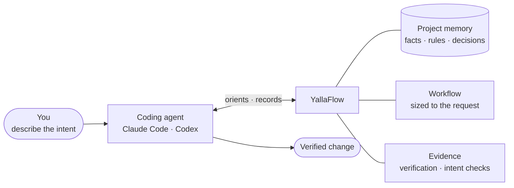
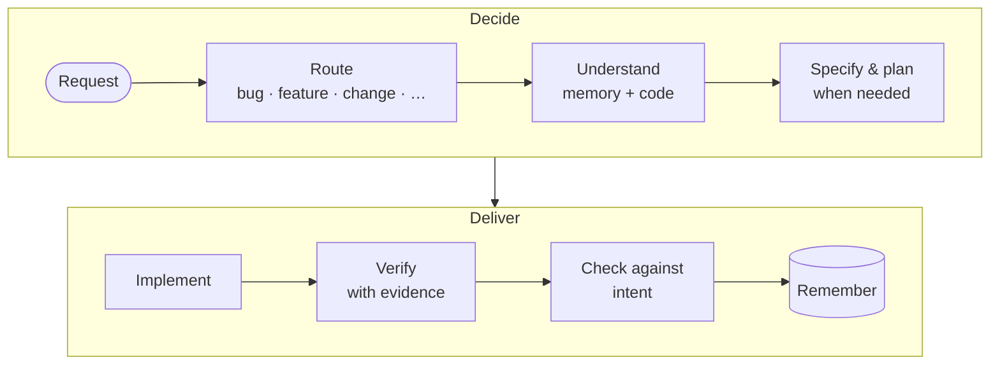
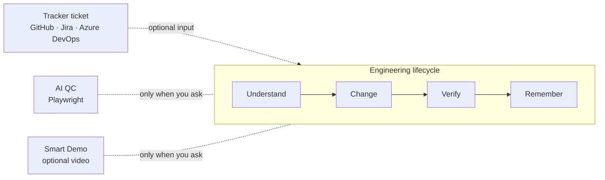

# YallaFlow

> **Give AI your project, not just your prompt.**

[](https://www.npmjs.com/package/yallaflow)
[](LICENSE)
[](docs/installation.md)
[](#how-it-works)

YallaFlow is an engineering governance layer for AI coding agents. **You describe the intent. YallaFlow supplies the rest:**

- **Project understanding.** A reviewed, durable memory of your codebase, so a new session never starts from zero.
- **The right workflow.** A bug, a feature, and an investigation each get a lifecycle sized to the work.
- **Evidence.** "Done" means verified and checked against what was asked, not just "the agent said so".

It works with **Claude Code** and **Codex**, runs locally, and keeps everything in your repository.

**Website:** [engmohamedamer.github.io/yallaflow](https://engmohamedamer.github.io/yallaflow/) · **npm:** [yallaflow](https://www.npmjs.com/package/yallaflow) · **Docs:** [Using YallaFlow](docs/using-yallaflow.md)

## Quick start

Requires **Node.js ≥ 20.16.0**.

```bash
npm install -g yallaflow
cd your-project
yallaflow init
```

`init` connects Claude Code (`CLAUDE.md`) and Codex (`AGENTS.md`) with a small pointer and keeps anything already in those files. Then open **Claude Code or Codex in the project** and describe the work. These are prompts for your agent, not terminal commands:

```text
Fix invoice totals.
```

```text
Build an anonymous employee survey platform.
```

You don't need to say "use YallaFlow", explain the architecture, or ask for specs and tests. Every session orients itself automatically.

**On an existing project, the first request comes with one review step.** The agent first builds an evidence-backed understanding of the codebase, without changing code. It shows you what it found and what it did not inspect, and waits for you to reply `Approve`. After that, your original request continues, and every later session and teammate starts from that approved understanding. [More on first use →](docs/using-yallaflow.md#3-first-use)

## How it works



The agent does the reasoning and the coding. YallaFlow keeps the durable state around it: what the project is, which workflow applies, and what has been proven. YallaFlow calls no AI model itself and sends no telemetry.

> **The complexity stays inside YallaFlow, not inside your prompt.**

## The engineering lifecycle



The depth adapts to the work. A bounded bug fix goes from root-cause analysis straight to the fix, while architectural work gets a reviewed design, specification, or plan. Nothing is called done without fresh verification evidence, and work that carries acceptance criteria is checked against them before it closes. What was learned becomes reviewed project knowledge. [Workflows in detail →](docs/workflows.md)

## What's new in 1.1.0

Three **optional** capabilities. If you don't use them, nothing changes.



**Connected requirements.** Point the agent at an existing ticket. Its description, acceptance criteria, comments and attachments become a preserved source, and the requirements trace back to it. The agent fetches the ticket with the integration it already has. YallaFlow can also fetch it read-only, using a token from your environment that is never stored.

```text
Implement acme/shop#42.
Work on SHOP-118 — https://acme.atlassian.net/browse/SHOP-118
```

**AI QC.** The agent plans functional and exploratory checks from the acceptance criteria, runs them with Playwright (CLI or MCP), and records what actually happened. A check counts as passed only if it was actually run and has evidence.

```text
Check that cancelling a booking works in the browser.
```

**Smart Demo.** The agent proposes the few scenarios worth showing, in priority order. You approve them before anything is recorded, and video is optional.

```text
Record a short demo of booking a pitch for the club owner.
```

**Good to know**

- QC and Smart Demo are **off by default**, independent of each other, and run **only when you ask**. They never start because a task finished.
- A demo shows scenarios working once. **It is not proof that tests passed.**
- Videos, screenshots, traces and generated reports stay on your machine and are **Git-ignored by default**. Only the lightweight `qc.json`/`demo.json` records are committed.
- Playwright must be available to your agent. Video recording also needs Playwright's ffmpeg (`npx playwright install ffmpeg`).

[Tickets, AI QC & Smart Demo guide →](docs/connected-requirements-and-quality.md)

## Teams

A maintainer runs `yallaflow init`, approves the project understanding, runs `yallaflow shared enable`, and commits `.yallaflow/`. Teammates just `git pull` and open their agent. They need no YallaFlow commands and no join step, only a compatible `yallaflow` CLI. Knowledge learned on a branch travels with that branch, and YallaFlow never commits, pushes, or merges for you. [Shared Projects →](docs/shared-projects.md)

> **Developers work with Git. Agents work with YallaFlow.**

## Upgrading from 1.0.x

```bash
npm install -g yallaflow@1.1.0
yallaflow agent refresh   # updates only YallaFlow-managed blocks (AGENT.md, CLAUDE.md, AGENTS.md)
yallaflow doctor
```

Existing work items, project memory and sources are unchanged. [Upgrading to 1.1.0 →](docs/upgrading-to-v1.1.0.md)

## Commands you might run yourself

Day to day, you talk to your agent. These are for setup and for looking under the hood:

```bash
yallaflow init       # once per project
yallaflow brief      # what YallaFlow knows and what's in progress
yallaflow status     # workflow state
yallaflow doctor     # integrity check
```

Everything else is in the [CLI reference](docs/cli.md).

## Documentation

The YallaFlow website, [engmohamedamer.github.io/yallaflow](https://engmohamedamer.github.io/yallaflow/), gives a one-page overview. The guides live in this repository:

| Guide | What it covers |
| --- | --- |
| [Using YallaFlow](docs/using-yallaflow.md) | the practical end-to-end guide: start here |
| [Installation](docs/installation.md) | install options, updating, legacy projects |
| [Tickets, AI QC & Smart Demo](docs/connected-requirements-and-quality.md) | connected requirements, optional QC and demos |
| [Shared Projects](docs/shared-projects.md) | one project understanding for the whole team, through Git |
| [Canonical workflows](docs/workflows.md) | Greenfield, Brownfield, bugs, features, investigations, teams |
| [Project memory](docs/project-memory.md) | durable context, evidence and freshness |
| [CLI reference](docs/cli.md) | every command and flag |
| [Architecture](docs/architecture.md) | internal concepts and design |
| [Security](docs/security.md) | trust model, secret redaction, network boundary |
| [Limitations](docs/limitations.md) | current boundaries |
| [Releasing & compatibility](docs/releasing.md) | Semantic Versioning and the compatibility promise |
| [Changelog](CHANGELOG.md) | release history |

## Status

**1.1.0** adds connected requirements and optional AI QC and Smart Demo. 1.0.0 was the first public, stable release. YallaFlow follows Semantic Versioning and keeps existing workspaces readable ([compatibility promise](docs/releasing.md#semantic-versioning-and-the-10-compatibility-promise)).

- **Local-first.** There is no YallaFlow server, account, or cloud service.
- **Agent-agnostic**, with first-party setup for Claude Code and Codex.
- **No AI calls and no telemetry.** YallaFlow touches the network only when you explicitly fetch a tracker ticket.
- **Not a project-management tool**, and not a bot that commits or pushes for you.

See [Limitations](docs/limitations.md) for current boundaries, for example that Windows is not yet verified.

---

**Agent reasons. YallaFlow governs. Project memory persists.**

> **Give AI your project, not just your prompt.**
