<p align="center">
  
</p>

<h1 align="center">YallaFlow</h1>

<p align="center"><b>Give AI your project, not just your prompt.</b></p>

<p align="center">
  <a href="https://www.npmjs.com/package/yallaflow"></a>
  <a href="LICENSE"></a>
  <a href="docs/installation.md"></a>
  <a href="#how-it-works"></a>
  <a href="docs/tour.ar.md"></a>
</p>

Your coding agent writes code fast. Then the next session forgets your project, and it says **"done"** without proof.

**YallaFlow fixes that.** It gives **Claude Code** and **Codex** a reviewed memory of your codebase, a workflow sized to each request, and evidence before anything is called done. A local console, in **English and Arabic**, lets you watch every request move and start your app with one button.

<p align="center">
  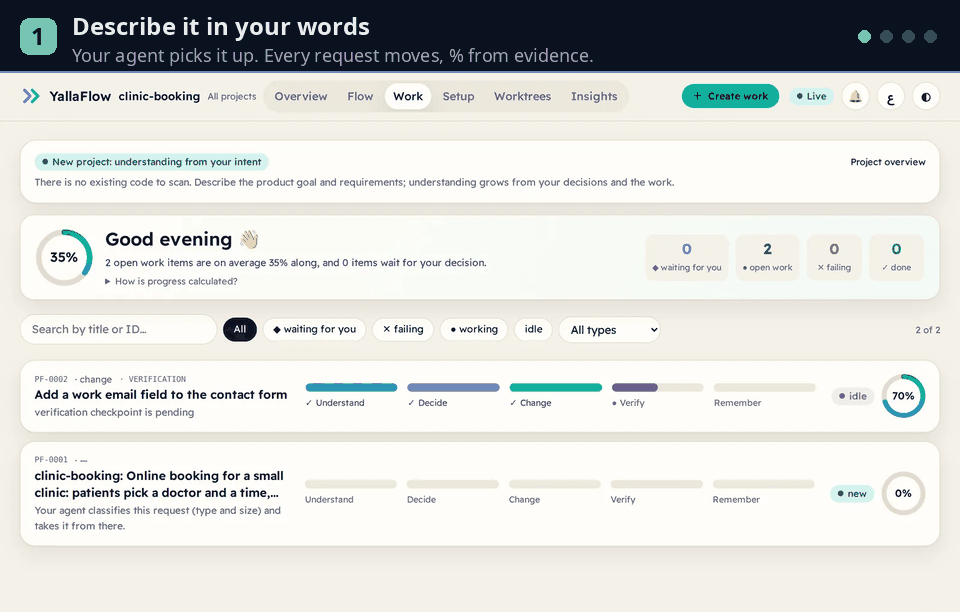
</p>

<p align="center">
  <a href="#install"><b>Install in 1 minute</b></a> ·
  <a href="docs/tour.md"><b>Visual tour</b></a> ·
  <a href="docs/tour.ar.md"><b>الجولة بالعربي</b></a> ·
  <a href="https://engmohamedamer.github.io/yallaflow/">Website</a> ·
  <a href="docs/using-yallaflow.md">Docs</a>
</p>

- **Project understanding.** A reviewed, durable memory of your codebase, so a new session never starts from zero.
- **The right workflow.** A bug, a feature, and an investigation each get a lifecycle sized to the work.
- **Evidence.** "Done" means verified and checked against what was asked, not just "the agent said so".
- **Your app, one button.** The agent works out how your project runs. You trust it once, then press **Start project**.
- **Run work your way.** Start one task now, or queue several to run one after another. You stay in control of every approval.

It runs locally, sends no telemetry, and keeps everything in your repository.

## The console: your project at a glance

`yallaflow console` opens a local web app in **Arabic or English**, light or dark. It shows every project, every request and every running service on one screen. Nothing runs on its own, and nothing leaves your machine.

| | |
| --- | --- |
| **Create work in your own words.** Write the request the way you'd tell a colleague, and attach a screenshot or a BRD if you have one. Your agent takes it from there.<br><br>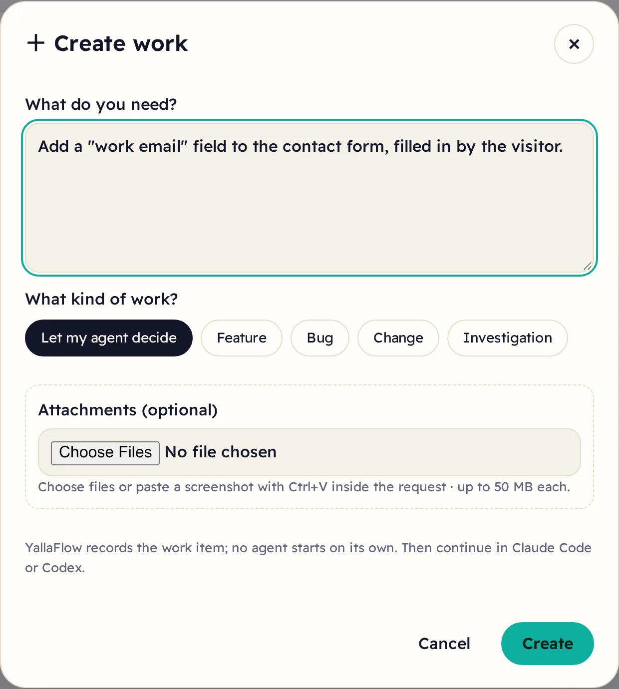 | **Watch every request move.** Each item moves through Understand → Decide → Change → Verify → Remember, and its % is computed from evidence.<br><br>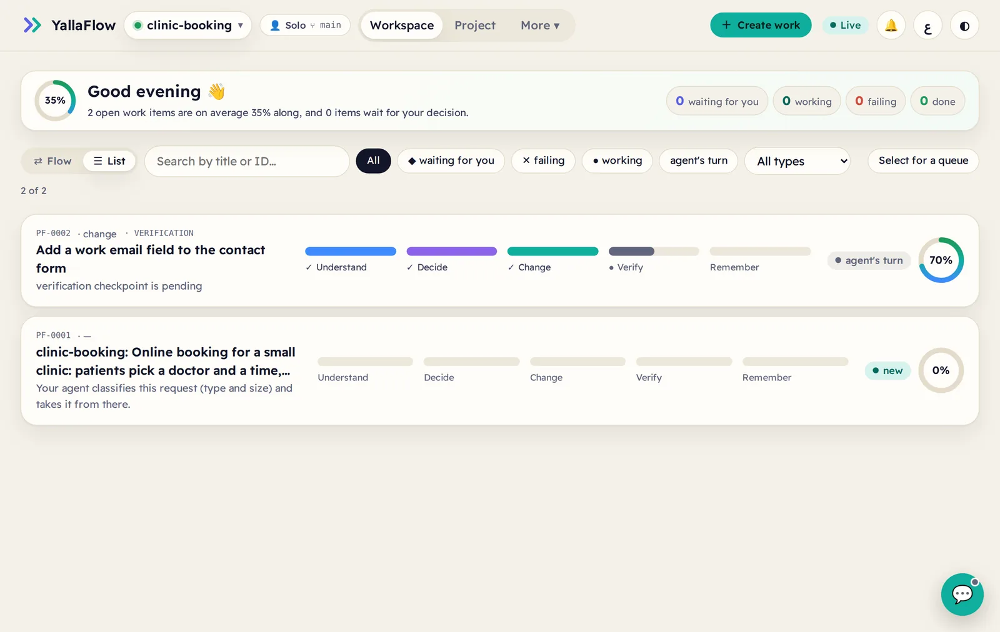 |
| **Get the app running with your agent.** The agent works out how the project really runs, including Docker, vhosts and parent folders, and proposes the services. You approve the exact commands once. Its investigation is read-only and never touches secrets.<br><br>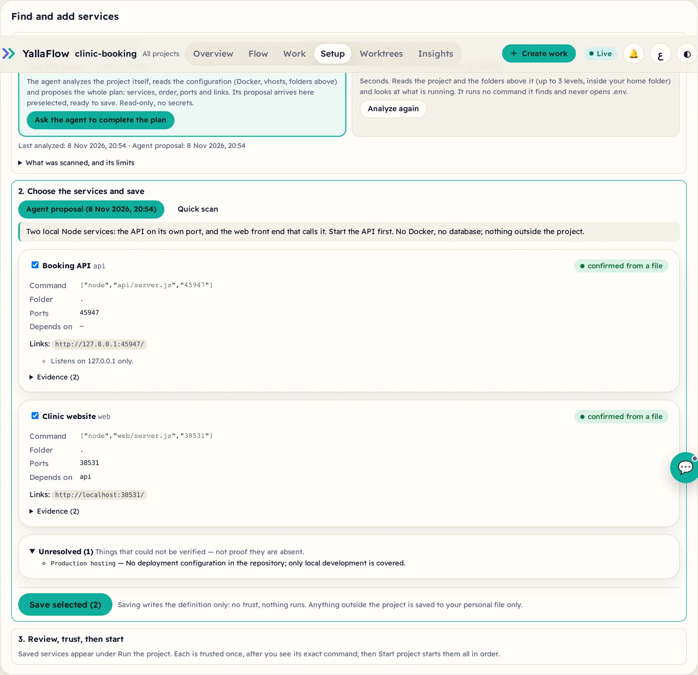 | **Then just press ▶ Start project.** One page shows the state, Start/Stop, the apps to open, and a row per service. Shared infrastructure is never stopped by mistake.<br><br>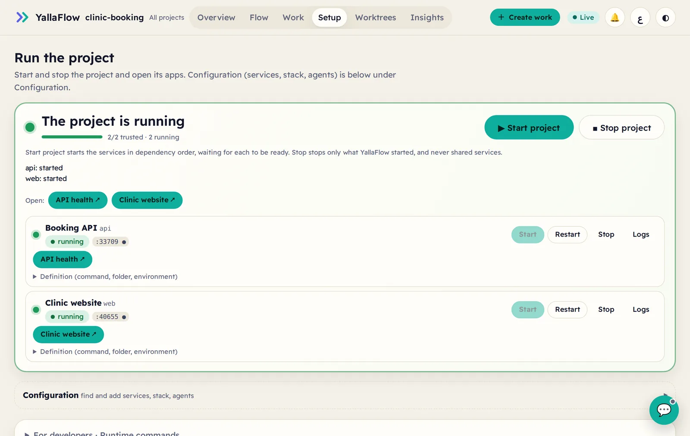 |

<details>
<summary><b>The same console in Arabic, dark theme</b> · نفس الكونسول بالعربي</summary>

| | |
| --- | --- |
| 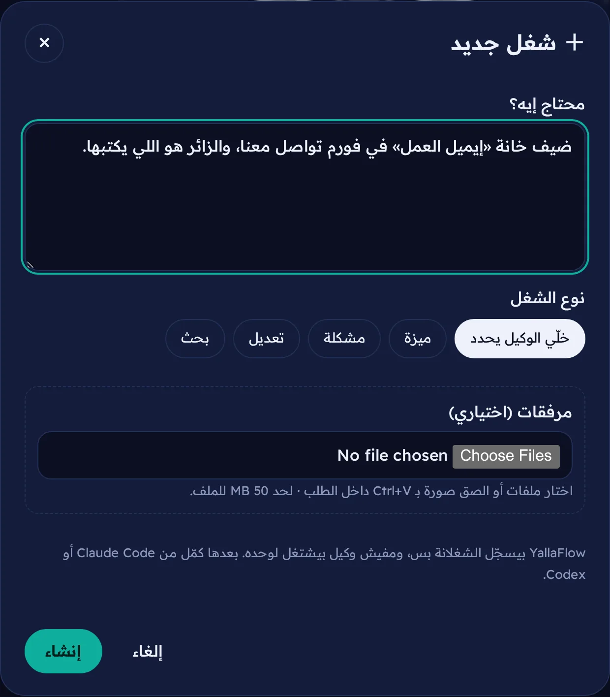 | 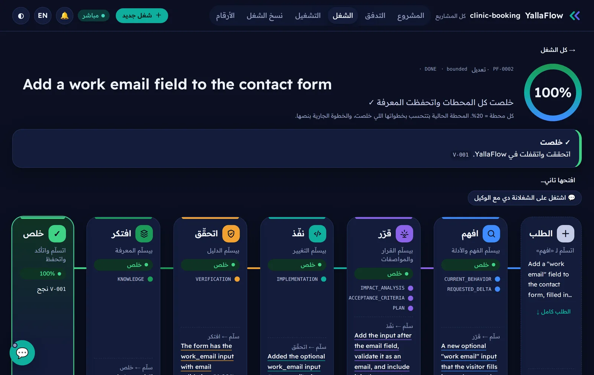 |
| 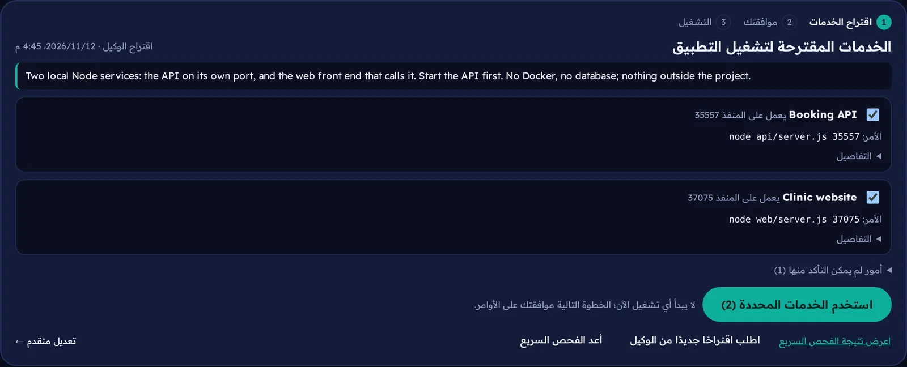 | 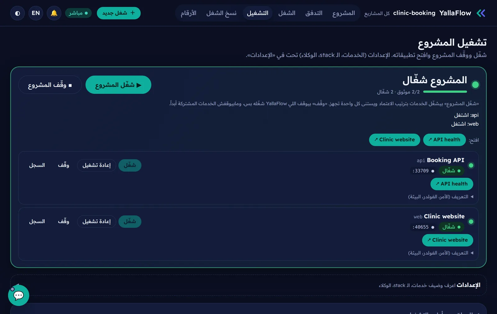 |

</details>

**[Take the full visual tour →](docs/tour.md)** It goes from an empty folder to a running app in 13 screens. **[الجولة كاملة بالعربي ←](docs/tour.ar.md)**

## Install

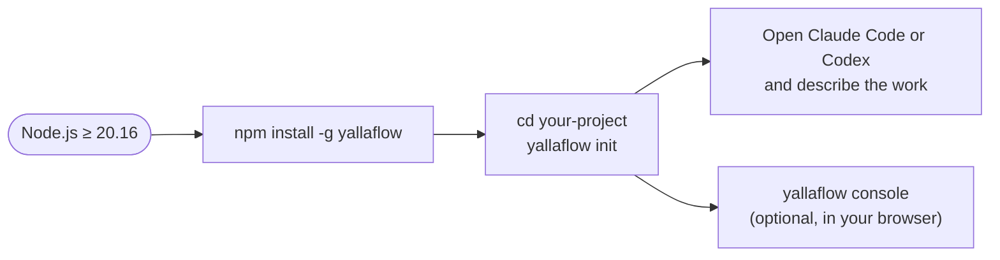

**1 · Install the CLI** (once per machine). Install it globally or in a tools prefix, never as a dependency of your app. [Options →](docs/installation.md)

```bash
npm install -g yallaflow
yallaflow --version
```

**2 · Connect a project** (once per project), or create a new one from the console's **New project** wizard:

```bash
cd your-project
yallaflow init
```

**3 · Work.** Open your agent in the project and describe the work, or open the console:

```bash
yallaflow console
```

`init` connects Claude Code (`CLAUDE.md`) and Codex (`AGENTS.md`) with a small pointer and keeps anything already in those files. Then open **Claude Code or Codex in the project** and describe the work. These are prompts for your agent, not terminal commands:

```text
Fix invoice totals.
```

```text
Build an anonymous employee survey platform.
```

You don't need to say "use YallaFlow", explain the architecture, or ask for specs and tests. Every session orients itself automatically.

**On an existing project, the first request comes with one review step.** The agent first builds an evidence-backed understanding of the codebase, without changing code. It shows you what it found and what it did not inspect, and waits for you to reply `Approve`. After that, your original request continues, and every later session and teammate starts from that approved understanding. [More on first use →](docs/using-yallaflow.md#3-first-use)

## Upgrade

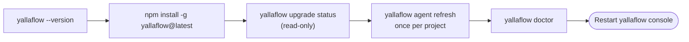

YallaFlow never updates itself and never checks the network for versions. You decide when to upgrade:

```bash
npm install -g yallaflow@latest     # or an exact version: yallaflow@1.5.2
yallaflow --version

# in each project
yallaflow upgrade status            # read-only: what, if anything, needs attention
yallaflow agent refresh             # only if the agent contract is reported outdated
yallaflow doctor
```

- **Your work is safe.** Work items, project memory and sources are kept as they are, and nothing is migrated without a command you run.
- **Restart the console** after upgrading, so the browser loads the new version (`Ctrl-C`, then `yallaflow console`).
- **Teams:** upgrade every machine and CI job that works on a Shared Project together.

[Updating in detail →](docs/installation.md#updating-yallaflow) · [Upgrading to 1.5.0 →](docs/upgrading-to-v1.5.0.md) · [1.4.0 →](docs/upgrading-to-v1.4.0.md) · [1.2.0 →](docs/upgrading-to-v1.2.0.md) · [from 1.0.x: 1.1.0 →](docs/upgrading-to-v1.1.0.md)

## How it works

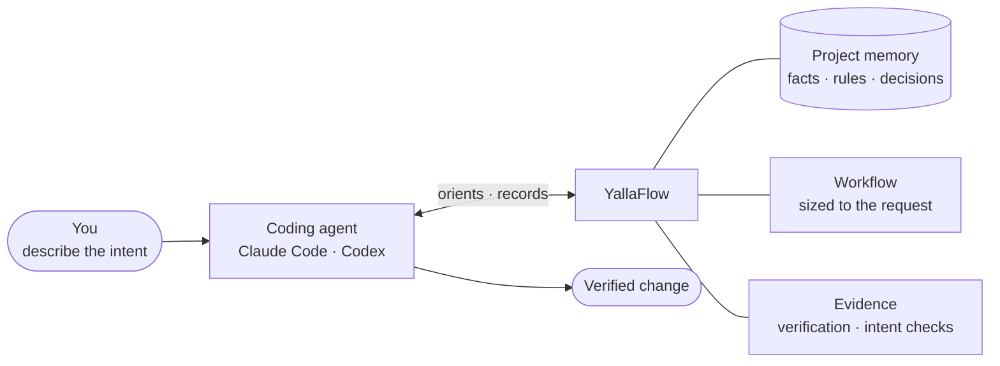

The agent does the reasoning and the coding. YallaFlow keeps the durable state around it: what the project is, which workflow applies, and what has been proven. YallaFlow calls no AI model itself and sends no telemetry.

> **The complexity stays inside YallaFlow, not inside your prompt.**

## The engineering lifecycle

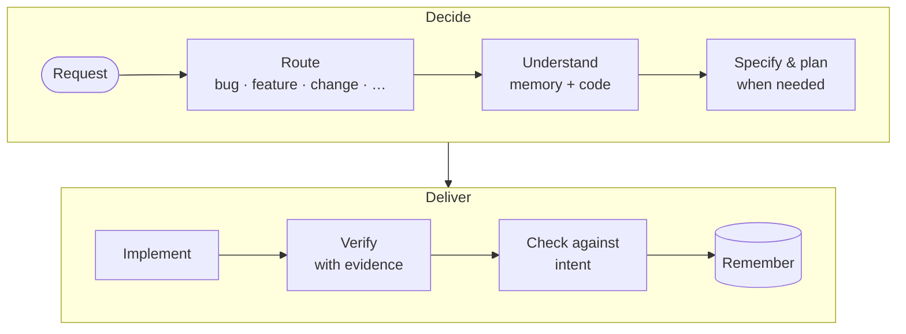

The depth adapts to the work. A bounded bug fix goes from root-cause analysis straight to the fix, while architectural work gets a reviewed design, specification, or plan. Nothing is called done without fresh verification evidence, and work that carries acceptance criteria is checked against them before it closes. What was learned becomes reviewed project knowledge. [Workflows in detail →](docs/workflows.md)

## What's new in 1.5.2

**An easier first hour.** [Changelog →](CHANGELOG.md#152---2026-11-12--an-easier-first-hour)

- **Connect an existing project from the console.** Choose a folder, review exactly what `yallaflow init` would change, and confirm. The folder picker works like a file dialog.
- **Workspace · Project · More.** One Project page with **Overview**, **Run** and **Settings** tabs, a project switcher in the header, and agents inside **All projects** with a **Needs you** inbox on top.
- **Choose the project's agent first.** Codex, or Claude Code as experimental. The console can install Codex, sign you in and test the connection, one approved step at a time.
- **Getting the app running is one guided flow.** The agent proposes the services, you approve the exact commands once, and the app starts.
- **Clicks, typing and scrolling survive live updates**, and Copy says "copied" only when it really copied.
- **Security:** `yallaflow init`, `agent setup` and `agent refresh` never write through a symbolic link outside the project.

## What's new in 1.5.1

**A steadier console.** [Changelog →](CHANGELOG.md#151---2026-11-10--steadier-console)

- The console no longer re-renders every second after an agent finishes a task while its session stays open.
- A button in the agent chat's header enlarges the chat for following long conversations.
- Team mode (Shared Project Mode) on the Overview is a clear card: what it means, its status, the branches, and one button.

## What's new in 1.5.0

**Queue your work, and stay in control of every approval.** [Changelog →](CHANGELOG.md#150---2026-11-10--queue-your-work) · [Execution modes →](docs/execution-modes.md)

- **Run Now.** One work item, one agent, right now. This is **Start**, as before.
- **Queue.** Pick several work items and they run one after another, each in a new agent session. The next one starts only when the current one is DONE and its session has ended. Anything that needs you pauses the queue, and the Agents tab controls it all.
- **Parallel** (off in 1.5.0). Each work item runs in its own lane, a Git worktree and branch beside your project, with its own agent. It stays off until a real-agent test confirms its security boundary.
- **Review, then merge by hand.** A finished lane shows readiness, the files it changed, conflicts, secret-looking content anywhere in its commits, and the exact Git steps to merge it yourself. A conflict is never resolved for you; you can send it back to the lane's agent. Automated Merge is off in 1.5.0 for security reasons and stays off until its checks can run safely.
- **Safe by default.** YallaFlow never pushes, rebases, resets or deletes branches, and in 1.5.0 it commits and merges nothing itself. Every Git command it starts turns off repository-configured fsmonitor, hooks and submodule recursion. [Security →](docs/security.md#review--merge-and-git)
- **Approval wait.** Choose how long a tool request waits for you: 5, 15, 30 or 60 minutes. When the wait runs out, the request is denied.
- **Overview: your branch and Shared Project Mode.** See the current branch and whether Shared Project Mode is on, and turn it on from there. Work items show their title first, with copyable IDs.

## What's new in 1.4.2

**A console that works with you.** [Changelog →](CHANGELOG.md#142---2026-11-09--a-console-that-works-with-you)

- **Start and let it run.** «Start» on a work item opens the chat with one instruction for the whole job; the agent stops only for a decision only you can make, and one button shows what is needed: review, answer, or continue.
- **See the agent from anywhere.** A card and a call-out show when the agent needs your approval or reply; the chat says how long it has worked and its last step.
- **Easier reviews and confirmations.** Reviews read like documents and expand to full screen; typing names is replaced by a single tick everywhere.
- **New projects.** Progress while it is created, a «project ready» screen, the agent chosen in the wizard, a «Something else» stack, and a Start here card.
- **Projects page.** Remove a saved project and see each project's memory health.
- **Claude Code on Team or Enterprise.** The console warns that channels must be enabled by the organization, and reports messages Claude Code never started on.

## What's new in 1.4.1

**Set the project up once, then run it from one page.** [See it →](docs/tour.md#part-3--set-the-project-up-once-then-just-press-start)

- **Ask the agent how the project runs.** On **Setup**, the agent analyzes the project and reads its real configuration: Docker Compose, vhosts, and the folders above the project. It then proposes services, start order, ports and `*.localhost` links, with confidence and evidence. The investigation is read-only, never opens `.env`, and marks what it can't verify as unresolved. The proposal arrives preselected. A quick scan without an agent is still there (`yallaflow runtime analyze`).
- **Run control first.** Once services are saved, Setup becomes the Run page. It shows one state, **▶ Start project** / **■ Stop project**, Open links, and a row per service with Start, Restart, Stop and Logs. Configuration folds away beneath.
- **Review and trust, once per service.** Trust is bound to the exact command, folder and files you reviewed. Any later change ends it.
- **Shared infrastructure is protected.** A Docker stack or database that serves other projects is never stopped by Stop project. Stopping it is a separate, typed confirmation.
- **A first-time setup guide** for existing projects: scan the stack, choose services, choose agents.

## What's new in 1.4.0

- **Work lifecycle.** Put work on hold, resume it, or close it without delivery (`yallaflow work hold|resume|close`). Closed work is never counted as done.
- **Manage work from the console.** Run YallaFlow's own actions on a work item, make review-gate decisions with a note, and edit a request before work starts. [Console →](docs/console.md)
- **Project Overview.** Stack from repository evidence, understanding from project memory, and guided onboarding. Run `yallaflow overview` or open the console's **Overview** tab.
- **Development runtime.** Start, stop and watch your app's services from the console's **Run** tab, after you approve their commands. [Runtime →](docs/runtime.md)
- **New Project Wizard.** Plan a new project with an official generator, review the exact commands, then create it. [New project →](docs/new-project.md)
- **An agent chat that keeps work moving.** The chat is on every console page: a work item page is that item's chat, and the other pages share a project chat. If an agent stops (for example, at a usage limit), the item offers to continue with another agent. Codex is supported, and Claude Code is available as an opt-in experiment. [Agents →](docs/agents.md)

## What's new in 1.3.0

- **Agent Workspace** (opt-in, `yallaflow console --agents`): work with Codex from the console using your own ChatGPT subscription. You get chat, live activity, and tool-permission requests next to the Flow. No API keys, ever. [Agent Workspace →](docs/agents.md)

## What's new in 1.2.0

- **A local console.** `yallaflow console` opens a browser view of your projects, in Arabic or English:
  - one action, **Create work**: a requirement in your own words and an optional BRD become a work item your agent continues;
  - the flow from New to Done across five stations, with completion % computed by YallaFlow from evidence;
  - what waits for you, and each item's next step;
  - acceptance criteria with their verification evidence;
  - attachments, Git worktrees, and insights from recorded data.
  [Console →](docs/console.md)
- **Safe for several agents.** A workspace write lock means two agents in one checkout never overwrite each other's records or get the same ID.
- **A read contract for scripts.** `yallaflow snapshot --json` and `yallaflow work show <id> --json` provide versioned JSON.

## What's new in 1.1.0

Three **optional** capabilities. If you don't use them, nothing changes.

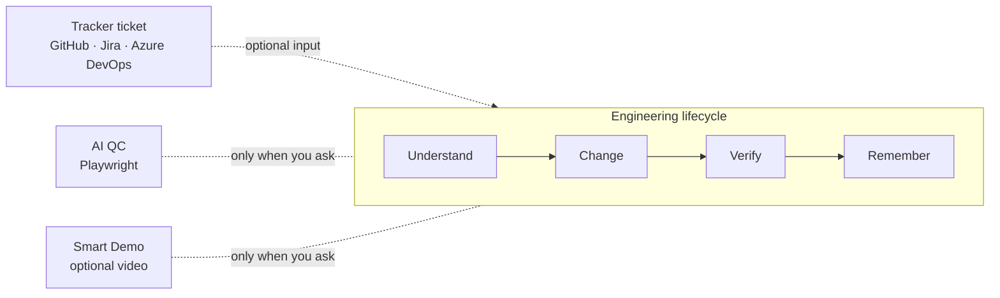

**Connected requirements.** Point the agent at an existing ticket. Its description, acceptance criteria, comments and attachments become a preserved source, and the requirements trace back to it. The agent fetches the ticket with the integration it already has. YallaFlow can also fetch it read-only, using a token from your environment that is never stored.

```text
Implement acme/shop#42.
Work on SHOP-118 — https://acme.atlassian.net/browse/SHOP-118
```

**AI QC.** The agent plans functional and exploratory checks from the acceptance criteria, runs them with Playwright (CLI or MCP), and records what actually happened. A check counts as passed only if it was actually run and has evidence.

```text
Check that cancelling a booking works in the browser.
```

**Smart Demo.** The agent proposes the few scenarios worth showing, in priority order. You approve them before anything is recorded, and video is optional.

```text
Record a short demo of booking a pitch for the club owner.
```

**Good to know**

- QC and Smart Demo are **off by default**, independent of each other, and run **only when you ask**. They never start because a task finished.
- A demo shows scenarios working once. **It is not proof that tests passed.**
- Videos, screenshots, traces and generated reports stay on your machine and are **Git-ignored by default**. Only the lightweight `qc.json`/`demo.json` records are committed.
- Playwright must be available to your agent. Video recording also needs Playwright's ffmpeg (`npx playwright install ffmpeg`).

[Tickets, AI QC & Smart Demo guide →](docs/connected-requirements-and-quality.md)

## Teams

A maintainer runs `yallaflow init`, approves the project understanding, runs `yallaflow shared enable`, and commits `.yallaflow/`. Teammates just `git pull` and open their agent. They need no YallaFlow commands and no join step, only a compatible `yallaflow` CLI. Knowledge learned on a branch travels with that branch. YallaFlow never pushes. It commits or merges only when you approve a Review & Merge in the console. [Shared Projects →](docs/shared-projects.md)

> **Developers work with Git. Agents work with YallaFlow.**

## Commands you might run yourself

Day to day, you talk to your agent. These are for setup and for looking under the hood:

```bash
yallaflow init       # once per project
yallaflow brief      # what YallaFlow knows and what's in progress
yallaflow status     # workflow state
yallaflow doctor     # integrity check
yallaflow console    # the flow in your browser; create work from there
```

Everything else is in the [CLI reference](docs/cli.md).

## Documentation

The YallaFlow website, [engmohamedamer.github.io/yallaflow](https://engmohamedamer.github.io/yallaflow/), gives a one-page overview. The guides live in this repository:

| Guide | What it covers |
| --- | --- |
| [Visual tour](docs/tour.md) · [العربية](docs/tour.ar.md) | 12 real console screens, from an empty folder to a running app |
| [Using YallaFlow](docs/using-yallaflow.md) | the practical end-to-end guide: start here |
| [Installation](docs/installation.md) | install options, updating, legacy projects |
| [Tickets, AI QC & Smart Demo](docs/connected-requirements-and-quality.md) | connected requirements, optional QC and demos |
| [Shared Projects](docs/shared-projects.md) | one project understanding for the whole team, through Git |
| [Canonical workflows](docs/workflows.md) | Greenfield, Brownfield, bugs, features, investigations, teams |
| [Project memory](docs/project-memory.md) | durable context, evidence and freshness |
| [Console](docs/console.md) | the local browser view, Create Work, New project, Setup |
| [Execution modes](docs/execution-modes.md) | Run Now, Queue, Parallel, Review & Merge |
| [Development runtime](docs/runtime.md) | analyze, review, trust, start and stop your app's services |
| [CLI reference](docs/cli.md) | every command and flag |
| [Architecture](docs/architecture.md) | internal concepts and design |
| [Security](docs/security.md) | trust model, secret redaction, network boundary |
| [Limitations](docs/limitations.md) | current boundaries |
| [Releasing & compatibility](docs/releasing.md) | Semantic Versioning and the compatibility promise |
| [Changelog](CHANGELOG.md) | release history |

## Status

**1.5.2** makes the first hour easier (connect a project, choose its agent, get the app running) on the console of 1.5.0, which runs work your way: one task now, or a queue of tasks one after another, with review and manual merge for lanes. Parallel execution and Automated Merge are disabled in this release. 1.0.0 was the first public, stable release. YallaFlow follows Semantic Versioning and keeps existing workspaces readable ([compatibility promise](docs/releasing.md#semantic-versioning-and-the-10-compatibility-promise)).

- **Local-first.** There is no YallaFlow server, account, or cloud service.
- **Agent-agnostic**, with first-party setup for Claude Code and Codex.
- **No AI calls and no telemetry.** YallaFlow touches the network only when you explicitly fetch a tracker ticket.
- **Not a project-management tool**, and not a bot that commits or pushes for you. It commits and merges only what you approve in Review & Merge, and it never pushes.

See [Limitations](docs/limitations.md) for current boundaries, for example that Windows is not yet verified.

---

**Agent reasons. YallaFlow governs. Project memory persists.**

> **Give AI your project, not just your prompt.**
