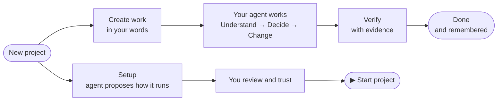

# A visual tour of YallaFlow 1.4.1

[العربية](tour.ar.md) · [README](../README.md) · [Console reference](console.md) · [Runtime reference](runtime.md)

This tour follows one project from an empty folder to a running app. A simple request goes from Create work to Done, and the project is set up so you start and stop it from one page. Every screen is the real console. The screens were captured from a demo project, and [the script that made them](../research/docs-tour/capture.mjs) can capture them again.

The console speaks **Arabic and English** and has **light and dark** themes. Each step shows both: English in light, Arabic in dark.

---

## Part 1 · From an empty folder to a project

### 1. Describe the idea

**All projects → New project** asks for a name, what you want to build, and where to create it. Requirements and attachments are optional.

| English | العربية |
| --- | --- |
|  |  |

### 2. Review exactly what will happen

Next you choose the stack and the environment. Before anything is created, the console shows **what will be created and what will not happen**: no overwrite, no remote, no commit or push, no service started and no agent started. **Create the project** carries out exactly this plan. If the plan changed, creation is refused.

| English | العربية |
| --- | --- |
|  |  |

### 3. The project's Overview

The new project opens on its Overview, a checklist built from real records. It shows what exists and what is next: goal, requirements, stack, development environment, Git and agent. Your description is already kept on the first work item.

| English | العربية |
| --- | --- |
|  |  |

---

## Part 2 · A simple request, from Create work to Done

### 4. Create work in your own words

Press **＋ Create work** and write what you need, as you would tell a colleague. You can attach a screenshot or a BRD. YallaFlow records the request, and no agent starts on its own.

| English | العربية |
| --- | --- |
|  |  |

### 5. Watch it move

Your agent (Claude Code or Codex) classifies the request: here, a *bounded change*. It then works through the stations. The **Work** board shows every item with its stations, its next step and a completion percentage. YallaFlow computes that percentage from evidence; it is not the agent's opinion.

| English | العربية |
| --- | --- |
|  |  |

### 6. One item, every station

Open an item to see each station: what was understood, what was decided, what changed, and what each step handed to the next. **Next step** says what is pending and who owns it. Here the agent has to verify. **Why it can't advance yet** names the exact blocker.

| English | العربية |
| --- | --- |
|  |  |

### 7. Done means proven

The agent ran a real check (`V-001`), and the knowledge review happened. Only then did the item become **Done: delivered, proven, remembered**. Passing tests alone never closes an item, and neither does the agent saying "done".

| English | العربية |
| --- | --- |
|  |  |

### 8. The whole flow at a glance

**Flow** puts every item on its station, from New to Done, with what is waiting for you, what is failing and what is working.

| English | العربية |
| --- | --- |
|  |  |

---

## Part 3 · Set the project up once, then just press Start

### 9. Let the agent work out how it runs

On **Setup**, **Ask the agent** comes first, and it is the recommended way. The agent analyzes the project itself and reads the real configuration: Docker Compose, vhosts, and the folders above the project. It then proposes the whole plan: services, start order, ports and links. Its investigation is read-only. It never opens `.env` and never copies a secret value. The **Quick scan** is the fallback when no agent is around.

The proposal shows its **confidence**, its **evidence**, and what remains **unresolved**. Unresolved means it could not be verified, which is not proof of absence. When the proposal arrives while the page is waiting, its services come **preselected**, so saving them is one click.

| English | العربية |
| --- | --- |
|  |  |

### 10. You review and trust: once per service

Saving writes the definitions only. Nothing runs, and nothing is trusted yet. Each service then shows **Review and trust**, which displays **exactly** what you are trusting: the command, the resolved folder, ports, readiness, and the files the trust is bound to. You type the service id to trust it. If any of those later changes, the trust ends until you review it again.

| English | العربية |
| --- | --- |
|  |  |

### 11. From now on: ▶ Start project

Once the project is configured, **Setup becomes the Run page**. One state sits on top, then the big **▶ Start project** and **■ Stop project** buttons, the apps to **Open**, and one compact row per service with Start, Restart, Stop and Logs. Start project starts the services in dependency order and waits for each one to be ready. Stop project stops only what YallaFlow started. It **never** stops shared infrastructure, such as a Docker stack or database that other projects use. Configuration (finding services, the stack, agents) is folded away beneath.

| English | العربية |
| --- | --- |
|  |  |

### 12. Same control on your phone

| English | العربية |
| --- | --- |
|  |  |

---

## What stayed true on every screen

- **Nothing runs on its own.** Opening the console starts nothing. A service runs only after you trust it, and an agent starts only when you send it a message.
- **No secrets leave your files.** Analysis never opens `.env`, plans list environment variable *names* only, and logs are redacted on a best-effort basis.
- **Human decisions stay human.** Creating a project, trusting a service, stopping shared infrastructure and approving review gates all need you.
- **Local only.** There is no YallaFlow server, no account and no telemetry. Your project state lives in `.yallaflow/`, in your repository.

Next: [Install or upgrade →](../README.md#install) · [Console reference →](console.md) · [Runtime reference →](runtime.md)
